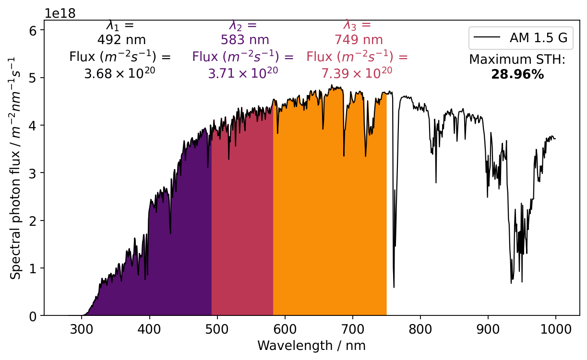
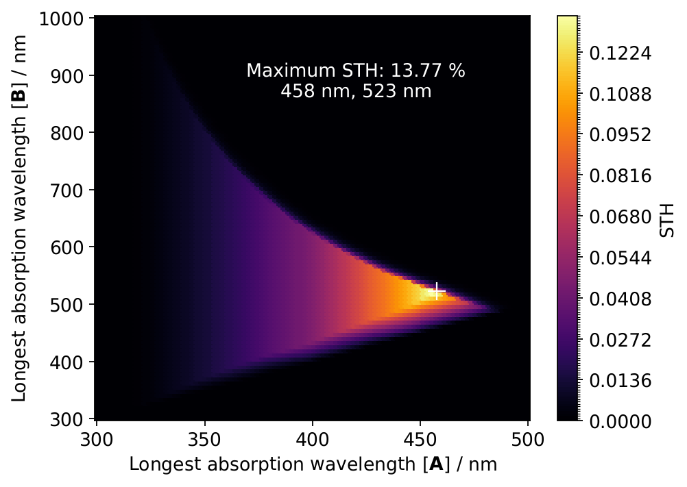

# Solar-to-hydrogen efficiency limits (`pyKES.utilities.solar_to_hydrogen_efficiency`)

A molecular catalyst that splits water with visible light rarely does it with a
single photon. The intermediates of its cycle absorb one after the other, each
up to its own absorption edge, and every turnover needs a fixed number of
photons from each of them. This module answers the question such a design
raises first: **what is the highest solar-to-hydrogen (STH) efficiency the
cycle could reach, and at which absorption edges?**

```python
import numpy as np
from pyKES.utilities.solar_to_hydrogen_efficiency import (
    SolarToHydrogenModel, evaluate_solar_to_hydrogen_efficiency,
    maximize_solar_to_hydrogen_efficiency, plot_spectrum_partition)
from pyKES.utilities.unit_handler import Quantity

# Overall water splitting stores 4 x 1.229 eV per O2; every absorbed photon
# loses 1 eV to the driving forces of the steps it powers.
model = SolarToHydrogenModel(gibbs_energy=Quantity(4 * 1.229, 'eV'),
                             excess_energy=Quantity(1.0, 'eV'))

# Three absorbers; the third has to absorb two photons per O2
optimum = maximize_solar_to_hydrogen_efficiency(model, number_photons=[1, 1, 2], seed=0)
optimum.efficiency.unit['%']      # 19.52
optimum.wavelengths.unit['nm']    # [460.4, 526.3, 640.9]

# Any other set of edges
result = evaluate_solar_to_hydrogen_efficiency(
    model, Quantity(np.array([450.0, 520.0, 650.0]), 'nm'), number_photons=[1, 1, 2])

plot_spectrum_partition(model, optimum)
```

The model is a port of `Data_Analysis/Solar_to_Hydrogen_Efficiency.py` from the
[Water-Splitting repository](https://github.com/jschneidewind/Water-Splitting),
written for Schneidewind et al., *Energy Environ. Sci.* 14, 4427 (2021)
([doi:10.1039/D1EE01053K](https://doi.org/10.1039/D1EE01053K)), whose ESI
section 11.5 describes it and tabulates its results. The port reproduces that
implementation — bit for bit in every optimization tested — and the published
tables; see [section 5](#5-validation-against-the-original-implementation).

---

## 0. Units

Inputs and outputs are [`Quantity`](guide/units.rst) objects:

- **Energies** — `gibbs_energy`, `excess_energy` and the complete Gibbs energy of
  `calculate_thermal_contribution` — may be given **per event** (dimension
  *energy*, e.g. `Quantity(4 * 1.229, 'eV')`) or **per mole** (dimension
  *energy / substance*, e.g. `Quantity(17.5, 'kcal / mol')`), the two ways they
  are usually quoted. A Gibbs energy refers to one reaction event, whatever the
  event is: 4 × 1.229 eV per O₂ for overall water splitting, 2 × 1.78 eV per
  H₂O₂ for the peroxide pathway. The reaction rate counts the same events.
- **Wavelengths** take any length unit, the **temperature** K or °C.
- The **efficiency** comes back dimensionless (read it with `.unit['%']`), the
  **reaction rate** as events per second and square metre of illuminated area,
  `mol / (s * m2)`.
- Arrays have to be NumPy arrays: `Quantity` multiplies the value by a
  conversion factor, which a Python list does not support.

Internally everything is reduced once, when the `SolarToHydrogenModel` is
built, to plain floats: wavelengths in nm, the energy balance in eV per event,
molar energies in J/mol and the spectrum in W m⁻² nm⁻¹. The optimization then
evaluates the model tens of thousands of times without touching the unit
handler.

> **Electronvolt and kilocalorie.** The
> pyKES electronvolt is 1.602176 × 10⁻¹⁹ J, truncated against the CODATA
> value — the original used the same number, so energies given in eV reproduce
> it exactly. The pyKES kilocalorie, however, is the thermochemical 4184 J, the
> original's was 4186.798188 J. A loss of `Quantity(17.5, 'kcal / mol')` is
> therefore 0.5 meV per photon smaller here than in the original, which moves
> optimal efficiencies by less than the optimizer's own run-to-run scatter
> (section 2). To reproduce the original exactly, write such energies as
> `Quantity(17.5 * 4186.798188, 'J / mol')`.

## 1. The model

```
absorption edges λ₁ < λ₂ < … (one per absorber), photons per event n₁, n₂, …
    │
    ├─► photon budget    the solar photon flux is cut into bands
    │                    [start, λ₁), [λ₁, λ₂), …; absorber i harvests Φᵢ
    │
    ├─► energy balance   deficit ΔE = ΔG − Σ nᵢ (hc/λᵢ − E_excess)
    │                    population p = exp(−ΔE / kT) if ΔE > 0, else 1
    ▼
reaction rate  r = p · minᵢ Φᵢ / (nᵢ N_A)    ──►    STH  η = r · ΔG / irradiance
```

The model follows Bolton, Strickler & Connolly (1985) and Seitz et al. (2014):
ideal absorbers that take up every photon below their edge and none above it,
with a quantum efficiency of one.

### Photon budget

The spectrum — AM 1.5 G (ASTM G173-03, global tilt) by default, shipped with
the package — is converted from spectral irradiance into spectral photon flux by
dividing by the photon energy $hc/\lambda$. The absorbers are stacked in order
of increasing absorption edge, and each harvests the photons between the
previous edge and its own:

$$\Phi_i = \int_{\lambda_{i-1}}^{\lambda_i} \phi(\lambda)\, d\lambda, \qquad \lambda_0 = \text{start of the spectrum}$$

That describes stacked absorbers, or molecular intermediates in solution at
concentrations such that each catches the light the previous one leaves.
Every reaction event needs $n_i$ photons from absorber $i$, so absorber $i$
alone could sustain $\Phi_i / n_i$ events per second and square metre. The
cycle runs only as fast as its most photon-starved absorber:

$$r = p \cdot \min_i \frac{\Phi_i}{n_i\, N_A}$$

Moving an edge to longer wavelengths enlarges one band at the expense of the
next, so the optimum balances the bands — in proportion to the photons each
absorber needs — against the energy each photon brings.

Edges out of increasing order leave an empty band, and an absorber with no
photons stops the cycle: the efficiency is zero. The optimizer never ends up
there, but it does sample such points.

### Energy balance

Every absorbed photon is counted at the energy of its absorber's **edge**, the
lowest energy that absorber takes up; whatever a shorter-wavelength photon
brings on top relaxes before it can do chemistry. From that it loses the
**excess energy**, which lumps together the free-energy loss inside the
absorber and the kinetic overpotential of the steps it powers. The study
behind this model used 0.76 eV (17.5 kcal/mol) as a lower bound for molecular
systems and 1 eV for comparison with semiconductors. If the photons together
fall short of the Gibbs energy of the reaction,

$$\Delta E = \Delta G - \sum_i n_i \left(\frac{hc}{\lambda_i} - E_\text{excess}\right) > 0,$$

the difference has to come from heat, and only the fraction of events
thermally activated across it — a two-state Boltzmann population at
298.15 K — goes on to react:

$$p = \exp\!\left(-\frac{\Delta E}{k_B T}\right) \quad (\Delta E > 0), \qquad p = 1 \quad (\Delta E \le 0)$$

With $k_B T$ = 25.7 meV, every additional 59 meV of deficit costs a factor of
ten in rate, so the optimum sits essentially at the edges where the deficit
closes.

### Efficiency

The efficiency is the Gibbs energy stored per second and square metre, divided
by the solar irradiance on that square metre:

$$\eta_\text{STH} = \frac{r \cdot \Delta G_m}{E_\text{total}}$$

with $\Delta G_m$ the molar Gibbs energy and $E_\text{total}$ the irradiance
integrated over the whole spectrum (1000.33 W m⁻² for AM 1.5 G, see section 3).
How much H₂ that corresponds to depends on what the event is: with
ΔG = 4 × 1.229 eV, one event is 2 H₂ + O₂.

### Heat as part of the energy budget

Some cycles are driven by light only part of the way and finish thermally — the
photochemical steps store `model.gibbs_energy`, a downstream thermal step the
rest of the complete reaction's Gibbs energy. The complete reaction then runs at
the light-limited rate, and the heat-supplied part adds

$$\eta_\text{thermal} = \frac{r \cdot (\Delta G_{m,\text{complete}} - \Delta G_m)}{E_\text{total}}$$

to the efficiency, which `calculate_thermal_contribution` returns. For the
two-photon cycle of the study, light drives [A] → 2 [F] + O₂ (82.7 kcal/mol)
and H₂ is released thermally (117.11 kcal/mol for the complete reaction):

```python
model = SolarToHydrogenModel(gibbs_energy=Quantity(82.7, 'kcal / mol'),
                             excess_energy=Quantity(17.5, 'kcal / mol'))
optimum = maximize_solar_to_hydrogen_efficiency(model, [1, 1], seed=0)
thermal = calculate_thermal_contribution(model, optimum, Quantity(117.11, 'kcal / mol'))
total = optimum.efficiency.unit['%'] + thermal.unit['%']    # 13.46 + 5.60 = 19.06
```

## 2. Finding the optimum

`maximize_solar_to_hydrogen_efficiency` searches every absorption edge between
300 and 3000 nm (`ABSORPTION_EDGE_BOUNDS`) with
`scipy.optimize.differential_evolution` at SciPy's default settings, as the
original did. The number of absorbers is the length of `number_photons`.

### Why a global search

The band limits snap to the tabulated wavelengths of the spectrum (section 3),
so the photon fluxes — and with them the efficiency — are **piecewise constant**
in the edges: flat plateaus between grid points, joined by steps, and modulated
only by the smooth Boltzmann factor. Gradients are zero or undefined almost
everywhere, and the many nearly equal plateaus are a trap for a local method.
The two published figures of the study were made with Nelder–Mead from a fixed
starting guess, and differential evolution finds better optima for both (both
columns with the original's kilocalorie):

| Cycle | Nelder–Mead (published) | Differential evolution |
|---|---|---|
| Three absorbers, photons [1, 1, 2], ΔG = 4 × 1.229 eV, 17.5 kcal/mol loss | 28.65 % at 491, 584, 748 nm | 28.96 % at 492, 583, 749 nm |
| Two absorbers, photons [1, 1], ΔG = 82.7 kcal/mol, 17.5 kcal/mol loss | 13.27 % at 455, 517 nm | 13.47 % at 456, 519 nm |

The Nelder–Mead path of the original — and its multi-start variant, dual
annealing and SHGO — were not ported.

### Seeds and scatter

On plateaus, differential evolution stops as soon as its population agrees to
within its tolerance, so where it stops depends on its random stream. `seed`
fixes that stream: a seeded call is reproducible, and the same seed retraces
the original implementation exactly (section 5). Unseeded — `seed=None` draws
from NumPy's global random state, as the original did — the result scatters
from run to run. For overall water splitting with a 1 eV loss, against the
published values (ESI Tables 11.5-1 to 11.5-4):

| Photons per absorber | Published | `seed=0` | 20 seeds |
|---|---|---|---|
| [2] | 1.22 % at 358 nm | 1.22 % at 358 nm | 1.13–1.22 %, 18 runs at 1.22 % |
| [4] | 12.33 % at 556 nm | 12.33 % at 556 nm | 12.33 % in every run |
| [1, 1] | 1.66 % at 348, 369 nm | 1.66 % at 348, 369 nm | 1.66 % in every run |
| [2, 2] | 17.09 % at 509, 613 nm | 17.09 % at 509, 614 nm | 17.09 % in every run |
| [4, 4] | 21.28 % at 658, 919 nm | 21.23 % at 658, 919 nm | 21.15–21.28 % |
| [1, 1, 1] | 11.79 % at 428, 475, 515 nm | 11.79 % at 428, 475, 516 nm | 11.72–11.79 % |
| [2, 2, 2] | 24.68 % at 557, 699, 850 nm | 24.78 % at 557, 699, 850 nm | 24.66–24.83 % |
| [1, 1, 2] | 19.58 % at 460, 526, 642 nm | 19.52 % at 460, 526, 641 nm | 19.52–19.58 % |
| [1, 1, 1, 1] | 21.08 % at 466, 536, 600, 661 nm | 21.08 % at 466, 536, 600, 661 nm | 21.02–21.08 % |
| [2, 2, 2, 2] | 26.37 % at 566, 716, 880, 1098 nm | 26.26 % at 566, 715, 878, 1095 nm | 26.26–26.34 % |

One or two absorbers are pinned down to the nanometre. With four, the last
edge sits on a long plateau and wanders over up to 13 nm while the efficiency
changes by 0.1 percentage points. Quote such results with that precision, or
rerun with a few seeds and keep the best.

### The result

Both `evaluate_solar_to_hydrogen_efficiency` and
`maximize_solar_to_hydrogen_efficiency` return a `SolarToHydrogenResult`:

| Field | Content | Dimension |
|---|---|---|
| `wavelengths` | Absorption edge of every absorber | length |
| `number_photons` | Photons every absorber takes up per event (plain array) | — |
| `efficiency` | Solar-to-hydrogen efficiency | dimensionless |
| `reaction_rate` | Reaction events per second and square metre | substance / (time · area) |
| `optimizer_result` | Raw `scipy.optimize.OptimizeResult` (`nfev`, `nit`, `success`, …); `None` for an evaluation | — |

The efficiency of an optimum is exactly the efficiency of its edges:
`evaluate_solar_to_hydrogen_efficiency(model, optimum.wavelengths, ...)` returns
the same number.

## 3. Details inherited from the original implementation

Two details of the original discretization are kept as they were, so that
results reproduce it:

- **Band limits snap to the grid.** An edge selects the nearest tabulated
  wavelength (`select_band`, via `pyKES.utilities.find_nearest`). The ASTM G173
  grid is 0.5 nm below 400 nm, 1 nm up to 1700 nm and 5 nm beyond, so edges are
  resolved to that step — the origin of the plateaus in section 2.
- **Bands are half-open.** A band runs from the grid point nearest its start up
  to, but *not including*, the grid point nearest its end
  (`integrate_spectrum`). The grid interval just below every edge is therefore
  counted in neither of the bands it separates. For the optimal two-absorber
  H₂O₂ cycle this makes both band fluxes 1.5 % smaller than closed bands would,
  and the efficiency 13.77 % instead of 13.98 %. The total irradiance loses its
  last interval in the same way: 1000.335 instead of 1000.371 W m⁻².

Changing either would change every number this module produces, which is why
they were kept for the port. Both are confined to `select_band` and
`integrate_spectrum`.

## 4. Figures

`plot_spectrum_partition` draws the photon flux and shades the band each
absorber harvests, with its edge and photon flux:



The first two bands need one photon per O₂ and hold equal fluxes; the third
needs two and holds twice as much. Where bands are narrow, `label_offsets`
moves the labels apart (as here, by −30, 0 and +40 nm).

`plot_efficiency_map` shows the efficiency of two absorbers against both edges,
here for the H₂O₂ pathway (2 × 1.78 eV, 17.5 kcal/mol lost per photon) with the
optimum marked:



Below the diagonal the edges are out of order and the efficiency is zero; to
the upper right the photons no longer carry enough energy and the Boltzmann
factor wipes the efficiency out within a few nanometres. `plot_efficiency_curve`
is the one-absorber counterpart, and `calculate_efficiency_map` returns the
numbers behind the map.

The figures keep the look of the original's, with three corrections:

- each band is labelled with the photon flux the efficiency is actually
  computed from. The original applied the half-open integration a second time
  to the band it had already cut out, so its labels showed 1–1.5 % less
  (3.64 × 10²⁰ instead of 3.68 × 10²⁰ m⁻² s⁻¹ for the first band above);
- band labels are centred on their bands. The original mixed a wavelength into
  an array of indices when placing them, which put the first label off centre;
- the efficiency label is placed relative to the axes rather than to the whole
  figure — the same spot in a single-panel figure, the right one in a
  multi-panel figure.

## 5. Validation against the original implementation

### Side by side with the original code

The port was run next to the original module in one process, with SciPy 1.17.1
and NumPy 2.4.4 — the latter after aliasing the removed `np.trapz` to
`np.trapezoid`, the same function under its new name. Every energy of the
original was handed to the port as the identical float in joules, and
optimizations of the original were seeded through NumPy's global random state
(`np.random.seed(s)`), those of the port with `seed=s`.

| Check | Cases | Result |
|---|---|---|
| Spectral irradiance and photon flux tables, total irradiance | AM 1.5 G | bit-identical |
| Efficiency and reaction rate at given edges | 18 000: the four energetics of the original study × ten photon sequences × 450 edge sets (sorted, unsorted, on grid points and on midpoints) | 95.7 % bit-identical, the rest within 7 × 10⁻¹⁴ relative |
| Differential evolution: edges, efficiency, printed line | 220 runs: four energetics, all ten sequences, seeds 0–9 | **bit-identical in all 220** |
| Thermal contribution and its printout | 10 seeded optima | identical |
| 100 × 100 efficiency map, colour levels and printed maximum | `secondary()` of the original | 93.9 % bit-identical, the rest within 3 × 10⁻¹⁴; levels and maximum identical |
| One-absorber efficiency curve | 400 edges | 95 % bit-identical, the rest within 6 × 10⁻¹⁴ |
| Spectrum partition figure | three optima | spectrum line, band fills, colours, edge labels and efficiency label identical; flux labels and label positions as described in section 4 |

The remaining last-bit differences are the original's: its `Energy` class
stores every intermediate in joules and converts it back to eV on every use,
and one round trip in seven moves the last bit. In none of the 220
optimizations did they change a comparison inside the optimizer, which is why
every one of them retraces the original exactly. The pinned values in
[test_solar_to_hydrogen_efficiency.py](https://github.com/jschneidewind/pyKES/blob/main/src/tests/test_solar_to_hydrogen_efficiency.py)
were computed by the original implementation.

### Against the published tables

ESI Tables 11.5-1 to 11.5-4 of the study list 22 optima — single to quadruple
absorbers, each with a 0.76 eV and a 1 eV loss — from unseeded runs of the
original. The port was run with 20 seeds on each:

- **16 entries** appear among those 20 runs, in 5 to 20 of them.
- **Q2** (four absorbers, two photons each) lies within the run-to-run scatter:
  34.05 % against 33.80–34.08 % at 0.76 eV, and 26.37 % at 1 eV, just above the
  26.26–26.34 % of these 20 runs but among the results unseeded runs of the
  original return.
- **Three entries** — T-1-1-2 at 0.76 eV and the two-photon/thermal cycle at both
  losses — lie below the optimum differential evolution finds in every run, and
  are what the published edges give when evaluated directly (28.65 %, 18.79 %,
  and 10.82 % against the published 10.83 %): they come from the Nelder–Mead
  path the figures were made with.
- **One entry** is not reproduced: D1 (two absorbers, one photon each) at
  0.76 eV, published as 3.29 %, comes out at 3.39 % in every run of the port
  and of the original code alike — most likely a transcription error in the
  table.

### Ground truth

The test suite adds closed-form ground truth on synthetic spectra with the same
photon flux at every wavelength, where every band integral is flux × width: a
single absorber's optimum is the grid cell holding its energy threshold, found
exactly for every grid step and seed tested, and two absorbers needing one and
two photons split the flux 1 : 2, found to within 0.2 % of the best split and
never above it.

**Speed** is unchanged: the ten optimizations of the table in section 2 take
1.2 s, as in the original.

## 6. Background reading

- J. Schneidewind, M. A. Argüello Cordero, H. Junge, S. Lochbrunner and
  M. Beller, *Energy Environ. Sci.* 14, 4427–4436 (2021) — the study this model
  was written for; ESI section 11.5 describes it and tabulates its results.
- J. R. Bolton, S. J. Strickler and J. S. Connolly, *Nature* 316, 495–500
  (1985) — limiting and realizable efficiencies of solar water splitting, the
  approach the model follows.
- L. C. Seitz, Z. Chen, A. J. Forman, B. A. Pinaud, J. D. Benck and
  T. F. Jaramillo, *ChemSusChem* 7, 1372–1385 (2014) — the same analysis for
  semiconductor single and dual absorbers, against which the 1 eV results can
  be compared.
- ASTM G173-03, *Standard Tables for Reference Solar Spectral Irradiances* —
  the AM 1.5 G spectrum, as distributed by NREL.
- R. Storn and K. Price, *J. Global Optim.* 11, 341–359 (1997) — differential
  evolution.
